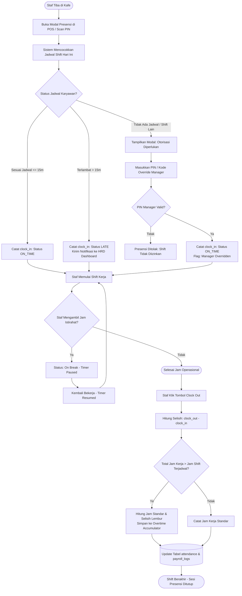
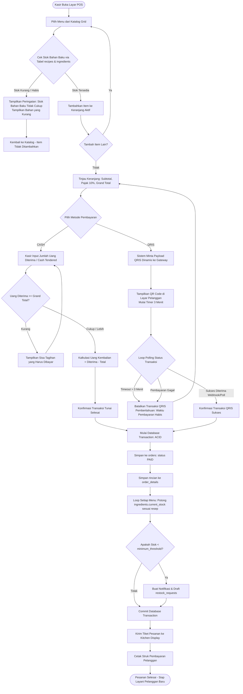
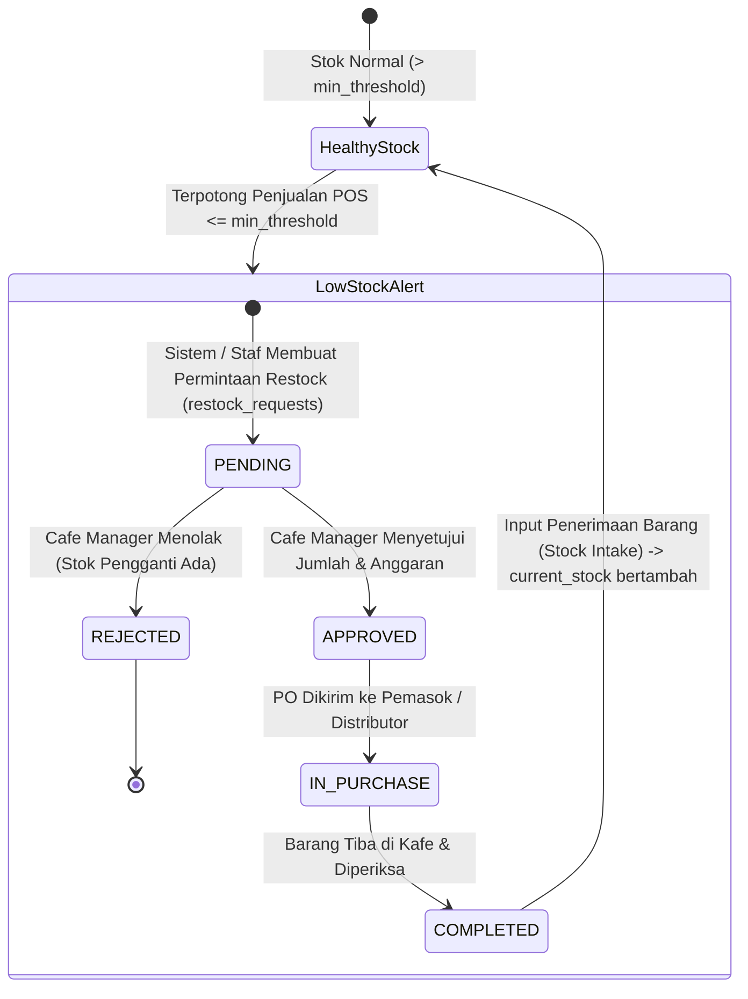
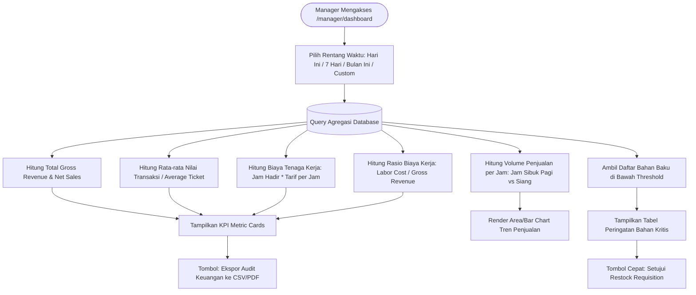

# CafeSync - Application Workflow & Business Logic Specification (`Appflow.md`)

**Document Version:** 1.0.0  
**Project:** CafeSync - Integrated Multi-Role Cafe Management Platform  
**Target Environment:** Local Laragon (PHP 8.3 / MySQL 8.4)  
**Author:** Lead System Architect & Senior Full-Stack Developer  

---

## 1. Pendahuluan & Ikhtisar Sistem (System Overview)

**CafeSync** adalah platform manajemen operasional kafe berbasis web modern (Warm Espresso Modern SaaS) yang dirancang untuk mengintegrasikan 4 pilar bisnis utama:
1. **Point of Sale (POS) & Automated Inventory Deduction**: Transaksi kasir dengan verifikasi resep bahan baku (*raw ingredients*) secara *real-time*.
2. **Shift Scheduling & Attendance Management**: Pencatatan presensi karyawan (*clock-in / clock-out*), validasi keterlambatan, lembur (*overtime*), dan integrasi basis data penggajian.
3. **Raw Supply & Inventory Control**: Pengawasan stok bahan baku mentah, peringatan stok kritis (*minimum threshold*), serta alur pengajuan & persetujuan *restock purchase orders*.
4. **Executive Analytics & Managerial Intelligence**: Visualisasi metrik finansial, rasio tenaga kerja (*labor cost ratio*), tren penjualan per jam, dan persetujuan pengadaan.

Sistem dirancang dengan arsitektur **Role-Based Access Control (RBAC)** ketat untuk tiga aktor utama: **Staff/Cashier**, **HRD Manager**, dan **Cafe Manager**.

---

## 2. Aktor & Matriks Hak Akses (RBAC Matrix)

| Fitur / Modul | Staff / Cashier / Barista | HRD Manager | Cafe Manager | Keterangan Akses |
| :--- | :---: | :---: | :---: | :--- |
| **Login & Auth Terminal** | ✅ | ✅ | ✅ | Multi-role portal login |
| **Clock-In / Clock-Out** | ✅ | ✅ | ✅ | Pencatatan presensi shift |
| **Override Jam Shift Tak Terjadwal** | ❌ | ❌ | ✅ | Memerlukan PIN / Otorisasi Manager |
| **POS Catalog & Cart** | ✅ | ❌ | ✅ | Pemilihan menu dan varian |
| **Checkout & Cash Payment** | ✅ | ❌ | ✅ | Kalkulasi uang diterima & kembalian |
| **Dynamic QRIS Payment** | ✅ | ❌ | ✅ | Polling status QRIS payment gateway |
| **Deduct Ingredient Stock** | ⚙️ (Otomatis) | ❌ | ⚙️ (Otomatis) | Terpotong via DB Transaction saat `PAID` |
| **Katalog Menu & Resep (CRUD)** | ❌ (View only) | ❌ | ✅ | Penentuan harga & resep per item menu |
| **Monitor Stok Bahan Baku** | 👁️ (View Stock) | ❌ | ✅ (Full CRUD) | Monitor bobot/volume bahan mentah |
| **Pengajuan Reorder Bahan (Restock)** | ✅ (Request) | ❌ | ✅ (Create & Approve)| Staff ajukan request, Manager setujui |
| **Manajemen Karyawan (Roster)** | ❌ | ✅ | ✅ | Tambah/edit profil & tarif per jam |
| **Jadwal Shift (Shift Scheduling)**| ❌ (View Own) | ✅ | ✅ | Penugasan jadwal shift mingguan |
| **Audit Log Presensi & Overtime** | ❌ | ✅ | ✅ | Rekapitulasi jam reguler & lembur |
| **Kalkulasi Estimasi Payroll** | ❌ | ✅ | ✅ | `total_hours * hourly_rate + overtime` |
| **Dashboard Eksekutif & Sales KPI**| ❌ | ❌ | ✅ | Revenue, Average Ticket, Margin |
| **Export Audit & Laporan Keuangan**| ❌ | ❌ | ✅ | Ekspor CSV / PDF laporan penjualan |

---

## 3. Pemetaan Alur Kerja End-to-End (Detailed Workflows)

### 3.1. Alur Otentikasi & Routing Berbasis Peran (Authentication & Role Routing)

```mermaid
flowchart TD
    Start([Pengguna Membuka CafeSync /login]) --> InputCred[Input Email / Username & Password]
    InputCred --> CheckAttempt{Gagal Login >= 3 Kali berturut-turut?}
    
    CheckAttempt -- Ya --> LockAccount[Kunci Akun Selama 15 Menit<br/>Catat Security Audit Log] --> ShowLockError[Tampilkan Peringatan: Akun Terkunci]
    CheckAttempt -- Tidak --> ValidateAuth{Verifikasi Hash Password di DB}
    
    ValidateAuth -- Tidak Valid --> IncAttempt[Counter Gagal Login +1] --> ShowAuthError[Tampilkan Pesan: Kredensial Salah]
    ValidateAuth -- Valid --> ResetAttempt[Reset Counter Gagal Login ke 0]
    ResetAttempt --> CreateSession[Buat Sesi Login & Token Autentikasi]
    CreateSession --> CheckRole{Cek Role Pengguna}
    
    CheckRole -- STAFF --> RouteStaff[/pos - Terminal POS Kasir & Presensi]
    CheckRole -- HRD --> RouteHRD[/hr - Portal Karyawan, Shift & Payroll]
    CheckRole -- MANAGER --> RouteManager[/manager/dashboard - Executive Analytics & Inventory]
```

#### Langkah-langkah & Business Rules Otentikasi:
1. **Form Entry**: Pengguna memasukkan email/username dan kata sandi. Pilihan role pada tampilan UI bersifat pembantu konteks stasiun kerja (*workstation filter*).
2. **Proteksi Brute-Force**:
   - Jika pengguna salah memasukkan kredensial sebanyak **3 kali berturut-turut**, akun langsung dikunci selama **15 menit** (`locked_until = NOW() + INTERVAL 15 MINUTE`).
   - Setiap upaya gagal dicatat ke log keamanan (`security_logs`).
3. **Penyimpanan Sesi**:
   - Sesi menggunakan *Secure HTTP-only Cookie* dengan masa aktif default 8 jam (standar shift kerja kafe).
4. **Role Redirection**:
   - `STAFF` dialihkan secara otomatis ke layar POS Terminal (`/pos`).
   - `HRD` dialihkan ke Dasbor Sumber Daya Manusia (`/hr/roster`).
   - `MANAGER` dialihkan ke Ringkasan Eksekutif (`/manager/dashboard`).

---

### 3.2. Alur Presensi Shift & Manajemen Waktu (Shift Attendance & Overtime)



#### Logika Jam Kerja & Presensi:
- **Toleransi Keterlambatan**: Toleransi keterlambatan adalah 15 menit dari jam mulai shift.
- **Perhitungan Lembur (*Overtime*)**:
  - Dihitung jika durasi kerja melebihi alokasi durasi shift (misal shift 8 jam, bekerja 9.5 jam = 1.5 jam *overtime*).
  - Jam lembur disimpan ke akumulasi bulanan untuk kalkulasi kompensasi: `gaji_pokok_shift + (jam_lembur * tarif_lembur)`.

---

### 3.3. Alur Pemesanan POS & Pemotongan Stok Bahan Baku Otomatis (POS Sale & Stock Deduction)



#### Aturan Bisnis Pemotongan Bahan Baku (*Inventory Deduction Formula*):
Setiap item menu terhubung dengan satu atau banyak bahan baku melalui tabel `recipes`:
$$\text{Pengurangan Stok Bahan } i = \sum (\text{amount\_required}_{i, m} \times \text{quantity\_ordered}_m)$$
*Contoh*: 1 Cup *Espresso Supreme* membutuhkan:
- Biji Kopi Arabica: 18 gram
- Air Filtrasi: 60 ml
- Paper Cup 8oz: 1 pcs

Jika pelanggan memesan 3 cup, sistem secara atomik memotong:
- Biji Kopi Arabica: $-54\text{ gram}$
- Paper Cup 8oz: $-3\text{ pcs}$

Jika stok biji kopi tersisa 30 gram, transaksi **ditolak** sejak awal penambahan ke keranjang (*early stock check*).

---

### 3.4. Alur Manajemen Persediaan & Pengajuan Reorder Bahan (Restock Lifecycle)



---

### 3.5. Alur Analisis Eksekutif & Dasbor Manager (Manager Analytics Flow)



---

## 4. Penanganan Kondisi Pengecualian & Edge Cases

1. **Jaringan Internet Terputus Saat Polling QRIS**:
   - Sistem menyediakan tombol `Manual Re-check Status` atau konfirmasi `Switch to Cash` jika gateway QRIS tidak merespons dalam 180 detik.
2. **Koreksi Transaksi / Void Order**:
   - Hanya Manager yang memiliki hak untuk melakukan `Void / Refund`. Jika void disetujui, stok bahan baku dikembalikan secara atomik (*reversal stock*).
3. **Selisih Stok Fisik vs Sistem (*Stock Variance*)**:
   - Manager dapat menjalankan modul *Stock Opname / Audit Variance* untuk mencatat selisih (*spillage, waste, expired*) dengan alasan penyesuaian yang tercatat di audit trail.
