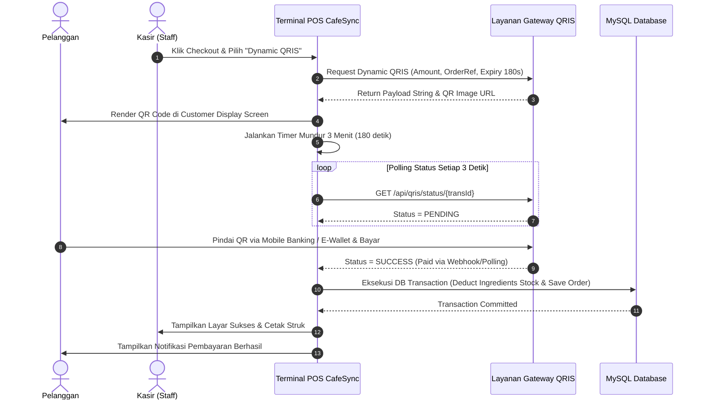

# CafeSync - Technical Architecture & System Design (`Architecture.md`)

**Document Version:** 1.0.0  
**Project:** CafeSync - Multi-Role Specialty Cafe Management Platform  
**Target Environment:** Local Laragon (PHP 8.3.33 / MySQL 8.4.3 / Node.js v22)  
**Author:** Lead System Architect & Senior Full-Stack Developer  

---

## 1. Pilihan Tech Stack & Rasional Arsitektur (Tech Stack Rationale)

Berdasarkan analisis terhadap spesifikasi sistem, komponen Stitch UI (Tailwind CSS, Inter, Plus Jakarta Sans), dan konfigurasi lingkungan server Laragon lokal yang telah terinstal:
- **PHP**: `8.3.33` (Win32 x64)
- **Database Engine**: `MySQL 8.4.3` (InnoDB ACID compliant)
- **Runtime Node.js**: `Node.js v22.x` & `npm`
- **Dependency Manager**: `Composer 2.x`

### 1.1. Rekomendasi Tech Stack Utama: **Laravel 11 + Blade / Alpine.js + Tailwind CSS**
*(Alternatif interaktivitas tinggi: **Laravel 11 + Livewire v3** atau **Laravel + Vue.js 3 via Inertia.js**)*

| Komponen | Teknologi | Rasional Pemilihan |
| :--- | :--- | :--- |
| **Backend Framework** | **Laravel 11.x** (PHP 8.3) | Standar industri untuk aplikasi SaaS monolitik tangguh; memiliki Eloquent ORM, Database Transactions bawaan, Middleware RBAC teruji, dan ekosistem keamanan matang. Sangat *native* berjalan di Laragon (`.test` virtual host). |
| **Database** | **MySQL 8.4.3 (InnoDB)** | Mendukung *foreign key constraints*, *ACID transactions*, serta *Row-Level Locking* (`SELECT ... FOR UPDATE`) untuk mencegah *race condition* saat dua kasir memesan menu dengan bahan baku yang sama secara bersamaan. |
| **Frontend Styling** | **Tailwind CSS v3.4+** | Kompatibel penuh dengan desain Stitch "Warm Espresso Modern", mudah diintegrasikan dengan custom color palette, border radius, dan typography tokens. |
| **Interaktivitas UI** | **Alpine.js 3.x / Livewire 3** | Menghadirkan reaktivitas instan pada keranjang POS (*cart addition, quantity toggle, real-time total & tax recalculation*) dan modal QRIS tanpa kompleksitas *build setup* SPA yang berlebihan. Sangat cepat diakses pada jaringan lokal kafe. |
| **Bundler & Compiler**| **Vite 5.x** | *Hot Module Replacement* (HMR) berkecepatan tinggi via Node.js v22 di Laragon. |
| **Otentikasi & Keamanan**| **Laravel Session & Bcrypt / Argon2id** | Enkripsi kata sandi kuat, proteksi CSRF otomatis, sesi *HttpOnly & SameSite=Lax*, serta middleware *RateLimiting*. |

---

## 2. Struktur Direktori Proyek (Project Folder Structure)

Struktur proyek mengikuti konvensi standar Laravel 11 dengan modularitas yang bersih:

```text
SI CafeSync/
├── app/
│   ├── Http/
│   │   ├── Controllers/
│   │   │   ├── Auth/
│   │   │   │   └── AuthController.php            # Login, Logout, Lockout handling
│   │   │   ├── POS/
│   │   │   │   ├── POSController.php             # Katalog menu, POS cart, checkout
│   │   │   │   └── PaymentController.php         # Transaksi Cash & Webhook/Polling QRIS
│   │   │   ├── HR/
│   │   │   │   ├── AttendanceController.php      # Clock-in, Clock-out, Override
│   │   │   │   ├── ShiftScheduleController.php   # Penjadwalan shift karyawan
│   │   │   │   └── PayrollController.php         # Rekapitulasi jam & payroll report
│   │   │   ├── Inventory/
│   │   │   │   ├── IngredientController.php      # CRUD stok bahan baku mentah
│   │   │   │   └── RestockController.php         # Pengajuan & persetujuan reorder
│   │   │   └── Manager/
│   │   │       ├── AnalyticsController.php       # Metrik penjualan, tren jam sibuk
│   │   │       └── MenuManagementController.php  # Manajemen menu & mapping resep
│   │   ├── Middleware/
│   │   │   ├── RoleMiddleware.php                # Validasi Role (STAFF, HRD, MANAGER)
│   │   │   └── PreventAccountLockout.php         # Verifikasi status akun terkunci (15m)
│   │   └── Requests/                             # Form Request Validation classes
│   ├── Models/
│   │   ├── User.php
│   │   ├── Attendance.php
│   │   ├── Ingredient.php
│   │   ├── Menu.php
│   │   ├── Recipe.php
│   │   ├── Order.php
│   │   ├── OrderDetail.php
│   │   └── RestockRequest.php
│   └── Services/
│       ├── InventoryService.php                  # Logika deduksi stok & cek threshold
│       ├── QRISPaymentService.php                # Gateway QRIS mock/sandbox provider
│       └── AttendancePayrollService.php          # Logika kalkulasi lembur & gaji
├── config/                                       # Konfigurasi aplikasi & payment
├── database/
│   ├── migrations/                               # Migration DDL 8 tabel utama
│   └── seeders/                                  # Initial users, menu & recipes seed
├── docs/                                         # Dokumentasi Arsitektur & Spesifikasi
│   ├── Appflow.md
│   ├── Architecture.md
│   ├── Changelog.md
│   ├── Database_Schema.md
│   └── UI_UX_Guidelines.md
├── public/                                       # Web root Laragon
│   ├── assets/
│   └── index.php
├── resources/
│   ├── css/
│   │   └── app.css                               # Tailwind styling & Stitch theme
│   ├── js/
│   │   └── app.js                                # Alpine.js / Livewire scripts
│   └── views/
│       ├── layouts/
│       │   ├── app.blade.php                     # Master layout dengan sidebar hangat
│       │   └── auth.blade.php                    # Layout login layar penuh
│       ├── auth/
│       │   └── login.blade.php                   # Layar multi-role login
│       ├── pos/
│       │   ├── terminal.blade.php                # Terminal POS kasir & keranjang
│       │   └── receipt.blade.php                 # Tampilan cetak thermal receipt
│       ├── hr/
│       │   ├── roster.blade.php                  # Daftar staf & shift aktif
│       │   └── attendance_logs.blade.php         # Rekap jam kerja & lembur
│       ├── inventory/
│       │   ├── raw_supplies.blade.php            # Monitor stok bahan baku mentah
│       │   └── restock_modal.blade.php           # Form reorder purchase order
│       └── manager/
│           ├── dashboard.blade.php               # Analytics eksekutif & chart volume
│           └── menu_recipes.blade.php            # Setup item menu & takaran resep
├── routes/
│   ├── web.php                                   # Routing antarmuka terotentikasi
│   └── api.php                                   # API status QRIS & POS telemetry
├── storage/                                      # Storage log, cache, dan sesi
├── .env.example
├── composer.json
├── package.json
├── tailwind.config.js                            # Palet warna Warm Espresso Modern
└── vite.config.js
```

---

## 3. Pola Desain Database & Integritas Transaksi (ACID Transactions)

Operasi paling krusial dalam CafeSync adalah **transaksi penjualan POS yang memotong stok bahan baku**. Untuk mencegah kegagalan data jika server mati mendadak atau terjadi konflik akses, seluruh proses dibungkus dalam **ACID Transaction** dengan *Pessimistic Locking*:

```php
// Pseudocode Implementasi Transaksi Kasir & Pemotongan Stok
DB::transaction(function () use ($cashierId, $cartItems, $paymentMethod, $tenderedAmount) {
    $totalAmount = 0;
    $orderDetails = [];

    // 1. Kunci baris bahan baku terkait untuk mencegah race condition
    foreach ($cartItems as $item) {
        $menu = Menu::with('recipes.ingredient')->findOrFail($item['menu_id']);
        $subtotal = $menu->price * $item['quantity'];
        $totalAmount += $subtotal;

        // Validasi ketersediaan bahan baku
        foreach ($menu->recipes as $recipe) {
            $requiredQty = $recipe->amount_required * $item['quantity'];
            $ingredient = Ingredient::where('ingredient_id', $recipe->ingredient_id)
                ->lockForUpdate()
                ->firstOrFail();

            if ($ingredient->current_stock < $requiredQty) {
                throw new InsufficientStockException("Stok {$ingredient->item_name} tidak mencukupi untuk pesanan ini.");
            }
        }
    }

    // 2. Simpan Header Pesanan (Orders)
    $order = Order::create([
        'user_id' => $cashierId,
        'total_amount' => $totalAmount,
        'payment_method' => $paymentMethod,
        'payment_status' => 'PAID',
    ]);

    // 3. Simpan Detail Pesanan & Potong Stok Bahan
    foreach ($cartItems as $item) {
        $menu = Menu::with('recipes.ingredient')->find($item['menu_id']);
        OrderDetail::create([
            'order_id' => $order->order_id,
            'menu_id' => $menu->menu_id,
            'quantity' => $item['quantity'],
            'subtotal' => $menu->price * $item['quantity'],
        ]);

        foreach ($menu->recipes as $recipe) {
            $requiredQty = $recipe->amount_required * $item['quantity'];
            $ingredient = Ingredient::find($recipe->ingredient_id);
            $ingredient->decrement('current_stock', $requiredQty);

            // 4. Periksa Batas Minimum & Buat Peringatan Otomatis
            if ($ingredient->current_stock <= $ingredient->minimum_threshold) {
                RestockRequest::firstOrCreate(
                    ['ingredient_id' => $ingredient->ingredient_id, 'status' => 'PENDING'],
                    [
                        'requested_by_user' => $cashierId,
                        'quantity_requested' => $ingredient->minimum_threshold * 2,
                    ]
                );
            }
        }
    }

    return $order;
});
```

---

## 4. Standar Endpoint & Arsitektur API (RESTful Endpoints)

Sistem menggunakan format respons standar JSON untuk komunikasi asinkron (misal: verifikasi ketersediaan stok, polling QRIS, pembaruan keranjang):

### 4.1. Format Respons Standar
```json
{
  "success": true,
  "code": 200,
  "message": "Transaksi berhasil diproses.",
  "data": {
    "order_id": 1042,
    "total_amount": 17.60,
    "payment_method": "QRIS",
    "payment_status": "PAID",
    "created_at": "2026-10-15 10:15:30"
  }
}
```

### 4.2. Matriks Rute Utama

| HTTP Method | URI Endpoint | Fungsi / Controller | Role Akses |
| :--- | :--- | :--- | :--- |
| `POST` | `/auth/login` | `AuthController@login` | Publik |
| `POST` | `/auth/logout` | `AuthController@logout` | Terotentikasi |
| `GET` | `/pos` | `POSController@index` | `STAFF`, `MANAGER` |
| `GET` | `/api/pos/menu` | `POSController@getAvailableMenu` | `STAFF`, `MANAGER` |
| `POST` | `/api/pos/orders` | `POSController@processOrder` | `STAFF`, `MANAGER` |
| `POST` | `/api/qris/generate` | `PaymentController@generateQR` | `STAFF`, `MANAGER` |
| `GET` | `/api/qris/status/{id}` | `PaymentController@checkStatus` | `STAFF`, `MANAGER` |
| `POST` | `/attendance/clock-in` | `AttendanceController@clockIn` | `STAFF`, `HRD`, `MANAGER` |
| `POST` | `/attendance/clock-out` | `AttendanceController@clockOut` | `STAFF`, `HRD`, `MANAGER` |
| `POST` | `/attendance/override` | `AttendanceController@overrideLate`| `MANAGER` |
| `GET` | `/inventory` | `IngredientController@index` | `MANAGER` |
| `POST` | `/inventory/restock` | `RestockController@createRequest` | `STAFF`, `MANAGER` |
| `PUT` | `/inventory/restock/{id}` | `RestockController@updateStatus` | `MANAGER` |
| `GET` | `/manager/dashboard` | `AnalyticsController@index` | `MANAGER` |
| `GET` | `/manager/export-sales` | `AnalyticsController@exportAudit` | `MANAGER` |

---

## 5. Arsitektur Keamanan Sistem (Security Architecture)

### 5.1. Enkripsi Kata Sandi & Validasi Kredensial
- Password dienkripsi menggunakan algoritma standar industri **Bcrypt** (cost 12) atau **Argon2id**.
- Plaintext password **tidak pernah** disimpan maupun dicatat ke log aplikasi.

### 5.2. Penanganan Percobaan Login Berulang (*Account Lockout Protection*)
- Sistem mencatat kegagalan login pada session / cache key: `login_attempts_{email}`.
- Jika terjadi **3 kali kegagalan berturut-turut**:
  1. Akun ditandai terkunci dengan stempel waktu: `locked_until = now()->addMinutes(15)`.
  2. Sistem menolak seluruh percobaan login berikutnya hingga jendela 15 menit terlewati.
  3. Insiden kegagalan dicatat ke file log audit keamanan.

### 5.3. Role-Based Access Control (RBAC) Middleware
- Setiap request melewati `RoleMiddleware` yang memverifikasi kolom `users.role`.
- Akses yang tidak sesuai hak akses memicu respons `403 Forbidden` atau *redirect* aman dengan pesan peringatan.

### 5.4. Keamanan Sesi & CSRF
- Seluruh form POST/PUT/DELETE wajib menyertakan `@csrf` token.
- Cookie sesi dikonfigurasi dengan:
  - `HttpOnly`: true (mencegah pencurian token via serangan XSS).
  - `SameSite`: Lax (mencegah eksploitasi CSRF).

---

## 6. Arsitektur Integrasi Pembayaran QRIS Dinamis (Dynamic QRIS Pipeline)



### Penanganan Timeout QRIS (3 Menit):
- Jika waktu 180 detik berakhir tanpa ada konfirmasi pembayaran:
  1. Polling dihentikan secara otomatis.
  2. Dialog peringatan ditampilkan di layar kasir: *"Waktu pembayaran QRIS telah habis."*
  3. Kasir diberikan opsi: **Regenerate QR** atau **Beralih ke Tunai (Switch to Cash)**.
  4. Tidak ada stok bahan baku yang terpotong sebelum status transaksi resmi menjadi `PAID`.
