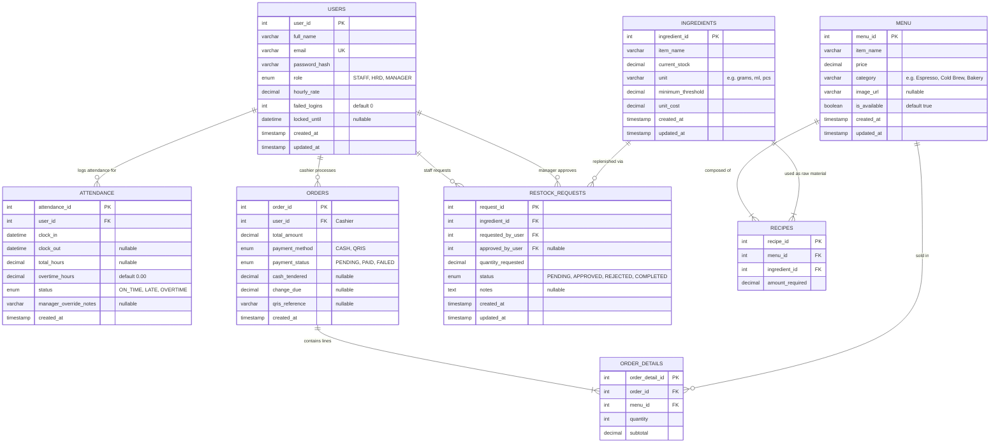

# CafeSync - Database Schema & ERD Documentation (`Database_Schema.md`)

**Document Version:** 1.0.0  
**Target RDBMS:** MySQL 8.4.x (InnoDB Engine, utf8mb4_unicode_ci)  
**Database Name:** `cafesync_db`  
**Author:** Lead System Architect & Senior Full-Stack Developer  

---

## 1. Visual Entity Relationship Diagram (ERD)

Berikut adalah diagram relasi entitas lengkap yang memodelkan relasi antar tabel dalam sistem CafeSync:



---

## 2. Kamus Data (Data Dictionary)

### 2.1. Tabel `users`
Menyimpan identitas pengguna, hak akses berbasis peran (RBAC), tarif gaji per jam, serta status proteksi penguncian akun.

| Kolom | Tipe Data | Nullable | Keterangan & Aturan |
| :--- | :--- | :---: | :--- |
| `user_id` | `INT AUTO_INCREMENT` | No | Primary Key |
| `full_name` | `VARCHAR(100)` | No | Nama lengkap karyawan |
| `email` | `VARCHAR(100)` | No | Email unik untuk kredensial login |
| `password_hash` | `VARCHAR(255)` | No | Hash Bcrypt / Argon2id dari password |
| `role` | `ENUM('STAFF', 'HRD', 'MANAGER')` | No | Peran dalam sistem (Default: `'STAFF'`) |
| `hourly_rate` | `DECIMAL(10,2)` | No | Tarif upah per jam untuk kalkulasi payroll (Default: `0.00`) |
| `failed_logins` | `INT` | No | Counter gagal login untuk proteksi brute force (Default: `0`) |
| `locked_until` | `DATETIME` | Yes | Waktu akhir akun terkunci (jika failed $\ge 3$) |
| `created_at` | `TIMESTAMP` | No | Waktu pembuatan akun |
| `updated_at` | `TIMESTAMP` | Yes | Waktu pembaharuan profil |

### 2.2. Tabel `attendance`
Mencatat waktu presensi (*clock-in / clock-out*), status ketepatan waktu, dan akumulasi lembur karyawan.

| Kolom | Tipe Data | Nullable | Keterangan & Aturan |
| :--- | :--- | :---: | :--- |
| `attendance_id` | `INT AUTO_INCREMENT` | No | Primary Key |
| `user_id` | `INT` | No | Foreign Key merujuk ke `users(user_id)` |
| `clock_in` | `DATETIME` | No | Waktu mulai kerja / shift |
| `clock_out` | `DATETIME` | Yes | Waktu selesai kerja / shift |
| `total_hours` | `DECIMAL(5,2)` | Yes | Durasi jam kerja aktif (`clock_out - clock_in`) |
| `overtime_hours` | `DECIMAL(5,2)` | No | Jam kerja lembur di luar shift normal (Default: `0.00`) |
| `status` | `ENUM('ON_TIME', 'LATE', 'OVERTIME')`| No | Status presensi (Default: `'ON_TIME'`) |
| `manager_override_notes` | `VARCHAR(255)` | Yes | Catatan persetujuan manager jika masuk di luar jadwal |
| `created_at` | `TIMESTAMP` | No | Stempel waktu pembuatan log |

### 2.3. Tabel `ingredients`
Menyimpan katalog bahan baku mentah (*raw materials*), jumlah stok terkini, satuan, dan batas ambang reorder.

| Kolom | Tipe Data | Nullable | Keterangan & Aturan |
| :--- | :--- | :---: | :--- |
| `ingredient_id` | `INT AUTO_INCREMENT` | No | Primary Key |
| `item_name` | `VARCHAR(100)` | No | Nama bahan mentah (contoh: Arabica Beans, Whole Milk) |
| `current_stock` | `DECIMAL(10,2)` | No | Jumlah stok fisik yang tercatat (Default: `0.00`) |
| `unit` | `VARCHAR(20)` | No | Satuan ukuran: `'grams'`, `'ml'`, `'pcs'`, `'shots'` |
| `minimum_threshold` | `DECIMAL(10,2)` | No | Ambang batas peringatan stok kritis (Default: `10.00`) |
| `unit_cost` | `DECIMAL(10,2)` | No | Harga beli modal per satuan unit (Default: `0.00`) |
| `created_at` | `TIMESTAMP` | No | Waktu pendaftaran bahan |
| `updated_at` | `TIMESTAMP` | Yes | Waktu modifikasi data stok |

### 2.4. Tabel `menu`
Katalog produk minuman dan makanan yang dijual kepada pelanggan di kasir POS.

| Kolom | Tipe Data | Nullable | Keterangan & Aturan |
| :--- | :--- | :---: | :--- |
| `menu_id` | `INT AUTO_INCREMENT` | No | Primary Key |
| `item_name` | `VARCHAR(100)` | No | Nama item menu (contoh: Espresso Supreme) |
| `price` | `DECIMAL(10,2)` | No | Harga jual per porsi |
| `category` | `VARCHAR(50)` | No | Kategori produk: `'Espresso'`, `'Cold Brew'`, `'Bakery'` |
| `image_url` | `VARCHAR(255)` | Yes | URL / path thumbnail menu untuk grid POS |
| `is_available` | `BOOLEAN` | No | Status aktif / tidak menu (Default: `TRUE`) |
| `created_at` | `TIMESTAMP` | No | Waktu penambahan menu |
| `updated_at` | `TIMESTAMP` | Yes | Waktu pembaruan menu |

### 2.5. Tabel `recipes` *(Junction Table Menu - Ingredients)*
Mendefinisikan komposisi takaran bahan baku yang dibutuhkan untuk memproduksi satu unit menu.

| Kolom | Tipe Data | Nullable | Keterangan & Aturan |
| :--- | :--- | :---: | :--- |
| `recipe_id` | `INT AUTO_INCREMENT` | No | Primary Key |
| `menu_id` | `INT` | No | Foreign Key merujuk ke `menu(menu_id)` ON DELETE CASCADE |
| `ingredient_id`| `INT` | No | Foreign Key merujuk ke `ingredients(ingredient_id)` |
| `amount_required`| `DECIMAL(10,2)` | No | Jumlah bahan baku yang dikonsumsi per porsi menu |

### 2.6. Tabel `orders`
Master data transaksi penjualan POS.

| Kolom | Tipe Data | Nullable | Keterangan & Aturan |
| :--- | :--- | :---: | :--- |
| `order_id` | `INT AUTO_INCREMENT` | No | Primary Key |
| `user_id` | `INT` | No | Foreign Key merujuk ke kasir yang bertugas di `users(user_id)` |
| `total_amount` | `DECIMAL(10,2)` | No | Total nominal pesanan (termasuk pajak jika ada) |
| `payment_method` | `ENUM('CASH', 'QRIS')` | No | Metode pembayaran |
| `payment_status` | `ENUM('PENDING', 'PAID', 'FAILED')`| No | Status transaksi (Default: `'PAID'`) |
| `cash_tendered`| `DECIMAL(10,2)` | Yes | Jumlah uang tunai diserahkan pelanggan |
| `change_due` | `DECIMAL(10,2)` | Yes | Uang kembalian yang diberikan |
| `qris_reference` | `VARCHAR(100)` | Yes | Kode unik referensi transaksi QRIS gateway |
| `created_at` | `TIMESTAMP` | No | Waktu terjadinya transaksi penjualan |

### 2.7. Tabel `order_details`
Rincian item produk yang dibeli dalam suatu nomor pesanan.

| Kolom | Tipe Data | Nullable | Keterangan & Aturan |
| :--- | :--- | :---: | :--- |
| `order_detail_id`| `INT AUTO_INCREMENT` | No | Primary Key |
| `order_id` | `INT` | No | Foreign Key merujuk ke `orders(order_id)` ON DELETE CASCADE |
| `menu_id` | `INT` | No | Foreign Key merujuk ke `menu(menu_id)` |
| `quantity` | `INT` | No | Jumlah porsi yang dipesan |
| `subtotal` | `DECIMAL(10,2)` | No | Nilai subtotal (`price * quantity`) |

### 2.8. Tabel `restock_requests`
Pencatatan pengajuan pembelian kembali bahan baku (*purchase requisition*) hingga tahap persetujuan Manager.

| Kolom | Tipe Data | Nullable | Keterangan & Aturan |
| :--- | :--- | :---: | :--- |
| `request_id` | `INT AUTO_INCREMENT` | No | Primary Key |
| `ingredient_id`| `INT` | No | Foreign Key merujuk ke `ingredients(ingredient_id)` |
| `requested_by_user`| `INT` | No | Foreign Key pemohon (Staf/Barista) `users(user_id)` |
| `approved_by_user` | `INT` | Yes | Foreign Key penanggung jawab (Manager) `users(user_id)` |
| `quantity_requested`| `DECIMAL(10,2)`| No | Volume/bobot bahan yang diajukan untuk dibeli |
| `status` | `ENUM('PENDING', 'APPROVED', 'REJECTED', 'COMPLETED')` | No | Status pengajuan (Default: `'PENDING'`) |
| `notes` | `TEXT` | Yes | Alasan pengajuan atau keterangan distributor |
| `created_at` | `TIMESTAMP` | No | Waktu pengajuan restock dibuat |
| `updated_at` | `TIMESTAMP` | Yes | Waktu persetujuan atau perubahan status |

---

## 3. SQL Data Definition Language (DDL) Skrip Siap Eksekusi

```sql
-- ========================================================
-- CafeSync Database Initialization Script
-- Target DBMS: MySQL 8.4+
-- ========================================================

CREATE DATABASE IF NOT EXISTS cafesync_db 
CHARACTER SET utf8mb4 
COLLATE utf8mb4_unicode_ci;

USE cafesync_db;

-- 1. Users Table (Role-Based Access & Lockout Protection)
CREATE TABLE IF NOT EXISTS users (
    user_id INT PRIMARY KEY AUTO_INCREMENT,
    full_name VARCHAR(100) NOT NULL,
    email VARCHAR(100) UNIQUE NOT NULL,
    password_hash VARCHAR(255) NOT NULL,
    role ENUM('STAFF', 'HRD', 'MANAGER') NOT NULL DEFAULT 'STAFF',
    hourly_rate DECIMAL(10,2) NOT NULL DEFAULT 0.00,
    failed_logins INT NOT NULL DEFAULT 0,
    locked_until DATETIME NULL,
    created_at TIMESTAMP DEFAULT CURRENT_TIMESTAMP,
    updated_at TIMESTAMP DEFAULT CURRENT_TIMESTAMP ON UPDATE CURRENT_TIMESTAMP,
    INDEX idx_user_role (role),
    INDEX idx_user_email (email)
) ENGINE=InnoDB;

-- 2. HR Attendance Logs
CREATE TABLE IF NOT EXISTS attendance (
    attendance_id INT PRIMARY KEY AUTO_INCREMENT,
    user_id INT NOT NULL,
    clock_in DATETIME NOT NULL,
    clock_out DATETIME NULL,
    total_hours DECIMAL(5,2) DEFAULT 0.00,
    overtime_hours DECIMAL(5,2) DEFAULT 0.00,
    status ENUM('ON_TIME', 'LATE', 'OVERTIME') DEFAULT 'ON_TIME',
    manager_override_notes VARCHAR(255) NULL,
    created_at TIMESTAMP DEFAULT CURRENT_TIMESTAMP,
    FOREIGN KEY (user_id) REFERENCES users(user_id) ON DELETE CASCADE,
    INDEX idx_attendance_user (user_id),
    INDEX idx_attendance_dates (clock_in, clock_out)
) ENGINE=InnoDB;

-- 3. Ingredients Inventory Table
CREATE TABLE IF NOT EXISTS ingredients (
    ingredient_id INT PRIMARY KEY AUTO_INCREMENT,
    item_name VARCHAR(100) NOT NULL,
    current_stock DECIMAL(10,2) NOT NULL DEFAULT 0.00,
    unit VARCHAR(20) NOT NULL, -- e.g., 'grams', 'ml', 'pcs'
    minimum_threshold DECIMAL(10,2) NOT NULL DEFAULT 10.00,
    unit_cost DECIMAL(10,2) NOT NULL DEFAULT 0.00,
    created_at TIMESTAMP DEFAULT CURRENT_TIMESTAMP,
    updated_at TIMESTAMP DEFAULT CURRENT_TIMESTAMP ON UPDATE CURRENT_TIMESTAMP,
    INDEX idx_stock_threshold (current_stock, minimum_threshold)
) ENGINE=InnoDB;

-- 4. Menu Catalog Table
CREATE TABLE IF NOT EXISTS menu (
    menu_id INT PRIMARY KEY AUTO_INCREMENT,
    item_name VARCHAR(100) NOT NULL,
    price DECIMAL(10,2) NOT NULL,
    category VARCHAR(50) NOT NULL, -- e.g., 'Espresso', 'Cold Brew', 'Bakery'
    image_url VARCHAR(255) NULL,
    is_available BOOLEAN DEFAULT TRUE,
    created_at TIMESTAMP DEFAULT CURRENT_TIMESTAMP,
    updated_at TIMESTAMP DEFAULT CURRENT_TIMESTAMP ON UPDATE CURRENT_TIMESTAMP,
    INDEX idx_menu_category (category),
    INDEX idx_menu_available (is_available)
) ENGINE=InnoDB;

-- 5. Recipes Junction Table (Menu - Ingredients Mapping)
CREATE TABLE IF NOT EXISTS recipes (
    recipe_id INT PRIMARY KEY AUTO_INCREMENT,
    menu_id INT NOT NULL,
    ingredient_id INT NOT NULL,
    amount_required DECIMAL(10,2) NOT NULL,
    FOREIGN KEY (menu_id) REFERENCES menu(menu_id) ON DELETE CASCADE,
    FOREIGN KEY (ingredient_id) REFERENCES ingredients(ingredient_id) ON DELETE RESTRICT,
    UNIQUE KEY uq_menu_ingredient (menu_id, ingredient_id),
    INDEX idx_recipe_menu (menu_id),
    INDEX idx_recipe_ingredient (ingredient_id)
) ENGINE=InnoDB;

-- 6. Orders Master Table
CREATE TABLE IF NOT EXISTS orders (
    order_id INT PRIMARY KEY AUTO_INCREMENT,
    user_id INT NOT NULL, -- Cashier who processed order
    total_amount DECIMAL(10,2) NOT NULL,
    payment_method ENUM('CASH', 'QRIS') NOT NULL,
    payment_status ENUM('PENDING', 'PAID', 'FAILED') DEFAULT 'PAID',
    cash_tendered DECIMAL(10,2) NULL,
    change_due DECIMAL(10,2) NULL,
    qris_reference VARCHAR(100) NULL,
    created_at TIMESTAMP DEFAULT CURRENT_TIMESTAMP,
    FOREIGN KEY (user_id) REFERENCES users(user_id) ON DELETE RESTRICT,
    INDEX idx_orders_created (created_at),
    INDEX idx_orders_status (payment_status),
    INDEX idx_orders_cashier (user_id)
) ENGINE=InnoDB;

-- 7. Order Details Line Items
CREATE TABLE IF NOT EXISTS order_details (
    order_detail_id INT PRIMARY KEY AUTO_INCREMENT,
    order_id INT NOT NULL,
    menu_id INT NOT NULL,
    quantity INT NOT NULL,
    subtotal DECIMAL(10,2) NOT NULL,
    FOREIGN KEY (order_id) REFERENCES orders(order_id) ON DELETE CASCADE,
    FOREIGN KEY (menu_id) REFERENCES menu(menu_id) ON DELETE RESTRICT,
    INDEX idx_detail_order (order_id),
    INDEX idx_detail_menu (menu_id)
) ENGINE=InnoDB;

-- 8. Restock Requests Table
CREATE TABLE IF NOT EXISTS restock_requests (
    request_id INT PRIMARY KEY AUTO_INCREMENT,
    ingredient_id INT NOT NULL,
    requested_by_user INT NOT NULL,
    approved_by_user INT NULL,
    quantity_requested DECIMAL(10,2) NOT NULL,
    status ENUM('PENDING', 'APPROVED', 'REJECTED', 'COMPLETED') DEFAULT 'PENDING',
    notes TEXT NULL,
    created_at TIMESTAMP DEFAULT CURRENT_TIMESTAMP,
    updated_at TIMESTAMP DEFAULT CURRENT_TIMESTAMP ON UPDATE CURRENT_TIMESTAMP,
    FOREIGN KEY (ingredient_id) REFERENCES ingredients(ingredient_id) ON DELETE RESTRICT,
    FOREIGN KEY (requested_by_user) REFERENCES users(user_id) ON DELETE RESTRICT,
    FOREIGN KEY (approved_by_user) REFERENCES users(user_id) ON DELETE RESTRICT,
    INDEX idx_restock_status (status)
) ENGINE=InnoDB;
```

---

## 4. Initial Seed Data (Data Awal untuk Pengujian Sistem)

Berikut adalah kumpulan kueri SQL untuk mengisi data dummy awal:

```sql
USE cafesync_db;

-- A. Seeder Pengguna (Password default: 'password123' ter-hash Bcrypt)
-- Hash Bcrypt dari 'password123': $2y$12$e80yVvUu3vVlU/4qA6fJ4.kY3gR1kPn5mZzV6uQh9B4e6p8bVj8.K
INSERT INTO users (full_name, email, password_hash, role, hourly_rate) VALUES
('Alex Rivera', 'cashier@cafesync.local', '$2y$12$e80yVvUu3vVlU/4qA6fJ4.kY3gR1kPn5mZzV6uQh9B4e6p8bVj8.K', 'STAFF', 15.00),
('Sarah Jenkins', 'barista@cafesync.local', '$2y$12$e80yVvUu3vVlU/4qA6fJ4.kY3gR1kPn5mZzV6uQh9B4e6p8bVj8.K', 'STAFF', 16.50),
('David Miller', 'hrd@cafesync.local', '$2y$12$e80yVvUu3vVlU/4qA6fJ4.kY3gR1kPn5mZzV6uQh9B4e6p8bVj8.K', 'HRD', 25.00),
('Elena Vance', 'manager@cafesync.local', '$2y$12$e80yVvUu3vVlU/4qA6fJ4.kY3gR1kPn5mZzV6uQh9B4e6p8bVj8.K', 'MANAGER', 35.00);

-- B. Seeder Stok Bahan Baku Mentah
INSERT INTO ingredients (item_name, current_stock, unit, minimum_threshold, unit_cost) VALUES
('Arabica Specialty Coffee Beans', 5000.00, 'grams', 1000.00, 0.05),
('Fresh Whole Milk', 15000.00, 'ml', 3000.00, 0.003),
('Oat Milk Barista Edition', 8000.00, 'ml', 2000.00, 0.006),
('Artisanal Matcha Powder', 1500.00, 'grams', 300.00, 0.12),
('French Butter Croissant Dough', 45.00, 'pcs', 10.00, 1.20),
('Vanilla Bean Syrup', 2500.00, 'ml', 500.00, 0.02),
('Takeaway Paper Cup 8oz', 200.00, 'pcs', 50.00, 0.15),
('Takeaway Cold Cup 16oz', 180.00, 'pcs', 50.00, 0.18);

-- C. Seeder Katalog Menu
INSERT INTO menu (item_name, price, category, is_available) VALUES
('Espresso Supreme', 3.50, 'Espresso', TRUE),
('Classic Flat White', 4.50, 'Espresso', TRUE),
('Iced Oat Matcha Latte', 5.50, 'Cold Brew', TRUE),
('Artisan Butter Croissant', 4.00, 'Bakery', TRUE),
('Nitro Cold Brew', 4.80, 'Cold Brew', TRUE);

-- D. Seeder Resep Komposisi Bahan
-- 1. Espresso Supreme (18g Arabica + 1 Paper Cup 8oz)
INSERT INTO recipes (menu_id, ingredient_id, amount_required) VALUES
(1, 1, 18.00),
(1, 7, 1.00);

-- 2. Classic Flat White (18g Arabica + 180ml Whole Milk + 1 Paper Cup 8oz)
INSERT INTO recipes (menu_id, ingredient_id, amount_required) VALUES
(2, 1, 18.00),
(2, 2, 180.00),
(2, 7, 1.00);

-- 3. Iced Oat Matcha Latte (12g Matcha + 200ml Oat Milk + 1 Cold Cup 16oz)
INSERT INTO recipes (menu_id, ingredient_id, amount_required) VALUES
(3, 4, 12.00),
(3, 3, 200.00),
(3, 8, 1.00);

-- 4. Artisan Butter Croissant (1 pcs Croissant Dough)
INSERT INTO recipes (menu_id, ingredient_id, amount_required) VALUES
(4, 5, 1.00);

-- 5. Nitro Cold Brew (25g Arabica + 1 Cold Cup 16oz)
INSERT INTO recipes (menu_id, ingredient_id, amount_required) VALUES
(5, 1, 25.00),
(5, 8, 1.00);
```
